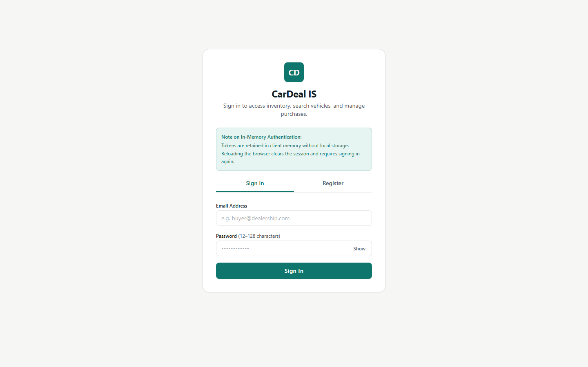
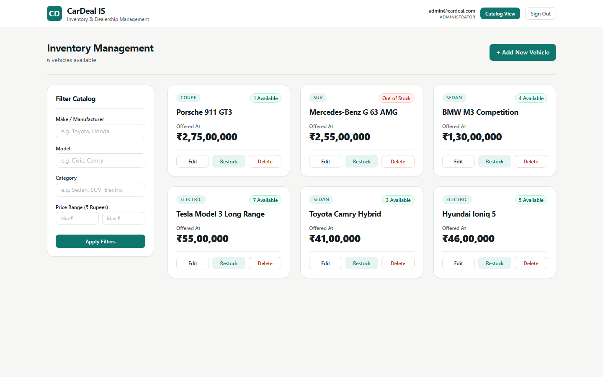
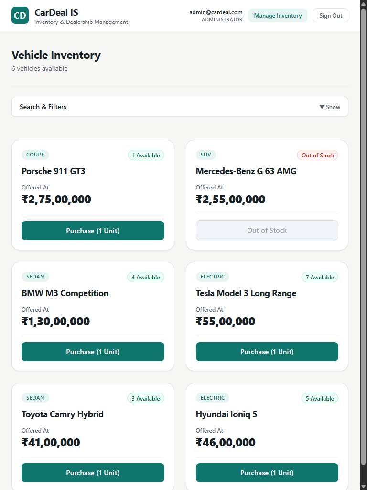
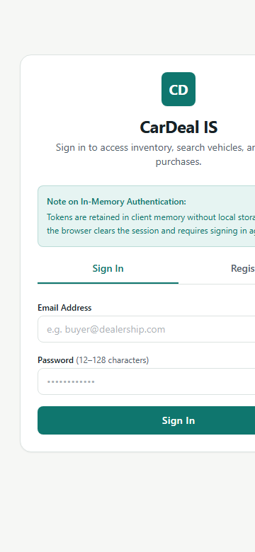

# CarDeal IS

A modern, full-stack Car Dealership Inventory System for Incubyte Round 1. Developed with AI assistance, backend Red-Green test cycles, independent code review, and documented verification.

## Implemented Functionality

- **User Authentication**: Token-based authentication using signed JWTs. Passwords hashed using non-truncating `scrypt` with salt and constant-time equality checks.
- **Role-Based Access**: Public registration defaults strictly to standard buyer privileges. Admin capabilities are managed server-side and provisioned via a dedicated local CLI tool.
- **Vehicle Catalog**: Protected browsing of inventory with stock quantity tracking, including zero-stock visibility.
- **Search & Filtering**: Multi-parameter search by make (case-insensitive substring), model (case-insensitive substring), category (case-insensitive exact match), and inclusive integer paise price bounds with SQL wildcard sanitization.
- **Atomic Transactions & Inventory**: Single-unit purchases with atomic stock decrement (`WHERE quantity > 0`) preventing negative inventory under concurrency. Admin-only additive restock increments with safe-integer validation.
- **Frontend SPA**: Original React, TypeScript, HTML5, CSS3, and Tailwind CSS user interface adhering to agreed visual tokens and responsive layouts.

## Architecture & Technology Stack

- **Backend API**: Node.js (`v26.7.0`), Express (`4.22.3`), TypeScript (`5.9.3`)
- **Database**: File-backed SQLite utilizing Node.js native built-in `node:sqlite` (`DatabaseSync` with WAL journal mode)
- **Security & Tokens**: Node built-in `crypto.scrypt`, `jsonwebtoken` (`9.0.3`) with brute-force rate limiting (`429 TOO_MANY_REQUESTS`)
- **Testing**: `vitest` (`2.1.9`), `supertest` (`7.3.1`), `@testing-library/react` (`16.3.3`), `@testing-library/jest-dom` (`6.9.1`)
- **Frontend SPA**: React (`18.3.1`), Vite (`5.4.21`), Tailwind CSS (`3.4.19`)

---

## Local Setup & Execution Guide

### Prerequisites
- **Node.js**: verified with `v26.7.0`. Use this tested runtime for reproduction; other versions have not been verified for this project.
- **npm**: verified with `11.19.0`.

### 1. Installation
Install dependencies for both backend and frontend from the repository root:
```bash
# Install backend packages
npm --prefix backend ci

# Install frontend packages
npm --prefix frontend ci
```

### 2. Environment Configuration
Create a `.env` file inside `backend/` (or copy from `backend/.env.example`):
```env
PORT=4000
DATABASE_PATH=./data/cardeal.db
# Generate a secure private key (e.g., openssl rand -hex 32)
JWT_SECRET=replace_with_a_secure_private_secret_at_least_32_characters_long
JWT_EXPIRES_IN=24h
CORS_ORIGIN=http://localhost:5173
```
Generate a private value before starting the server, for example with `node -e "console.log(require('node:crypto').randomBytes(32).toString('hex'))"`, and replace the placeholder. The backend requires an explicitly configured secret of at least 32 characters; a long placeholder can pass this length check and must not be used as a real secret.

### 3. Local Administrator Provisioning
Provision an initial administrator account locally without exposing public role selectors or default passwords:
```bash
# From repository root:
npm run admin:provision admin@cardeal.com AdminPassword123!

# Or from backend directory:
npm run admin:provision admin@cardeal.com AdminPassword123!
```

Replace the example administrator email and password with your own local values. Do not reuse the published example password for a deployed instance.

### 4. Running the Complete Application

#### Start the Backend API (Port 4000)
```bash
# Development mode (auto-reload via tsx):
npm run dev:backend

# Or build and run production:
npm run build:backend
npm --prefix backend start
```

#### Start the Frontend SPA (Port 5173)
```bash
# In a separate terminal:
npm run dev:frontend
```
Open your browser to `http://localhost:5173`.

---

## Running the Test Suites

Both backend and frontend feature automated test suites running on Vitest. Verification results, scope limitations and recorded terminal execution logs are documented in [TEST_REPORT.md](TEST_REPORT.md).

### Run All Tests (Root - 55 Tests across 17 Suites)
```bash
npm test
```

### Run Backend Tests Separately (39 Tests in 12 Suites)
```bash
npm run test:backend
```
Backend coverage includes:
- `canary.test.ts`: Tooling and TypeScript runtime verification.
- `auth_registration.test.ts`: User registration persistence in SQLite with scrypt password verification.
- `auth_validation.test.ts`: Email regex, password length bounds (12–128 chars), 409 duplicate email conflicts, and role escalation prevention.
- `auth_login.test.ts`: Credential verification, JWT issuance with expiration, and generic 401 INVALID_CREDENTIALS.
- `auth_middleware_and_admin.test.ts`: Bearer token authentication, 401/403 status enforcement, and admin CLI provisioning.
- `vehicles_crud.test.ts`: Admin vehicle creation, integer paise price validation, zero-stock catalog listing, PUT detail update with quantity modification rejection, and admin deletion.
- `vehicles_search.test.ts`: Substring make/model search, exact category filter, inclusive paise bounds, reversed bounds rejection (400), and SQL `LIKE` wildcard escaping.
- `purchase_and_restock.test.ts`: Atomic 1-unit purchase, 409 OUT_OF_STOCK handling, concurrent competing requests for the final unit (exactly 1 succeeds, 1 gets 409 conflict, final stock 0), and admin additive restock.
- `database_restart_persistence.test.ts`: Closes and reopens the same database file within one test process, verifies stored users/vehicles, and makes a purchase after reopening. It does not restart the operating-system process or reopen again after that purchase.
- `regression_fixes.test.ts`: Regression suite verifying explicit secret enforcement, expired tokens, brute-force throttling, safe-integer boundaries, concurrent duplicate registration, and strict mutation payloads.
- `phase3_regressions.test.ts`: Focused regression suite verifying atomic SQL restock upper-bound overflow prevention and subprocess CLI execution with custom database path.
- `e2e_integration_flow.test.ts`: Multi-step HTTP API integration test. It does not drive the React application in a browser.

### Run Frontend Tests Separately (16 Tests in 5 Suites)
```bash
npm run test:frontend
```
Frontend coverage includes:
- `currency.test.ts`: Precise rupee-to-paise conversion, rejection of malformed currency and fractional paise, and Indian currency formatting (`₹`).
- `VehicleCard.test.tsx`: Card rendering, price formatting, zero-stock disablement, in-flight spinner state, and admin controls.
- `AdminModal.test.tsx`: Strict non-negative integer quantity validation, rejection of fractional/malformed inputs, ESC key close, and keyboard focus trap.
- `AuthView.test.tsx`: Authentication view error handling verifying invalid credentials do not misattribute as session expiration.
- `App.test.tsx`: Application view rendering and form validation bounds.

---

## Screenshots

Actual screenshots captured from the live application using headless Chrome across desktop, tablet, and mobile viewports with authenticated session state:

### Desktop Customer Catalog View (1440px Viewport)


### Desktop Admin Management View (1440px Viewport)


### Tablet Customer Catalog View (768px Viewport)


### Mobile Customer Catalog View (360px Viewport)


---

## Known Design Trade-offs & Current Limitations

1. **In-Memory Session Storage**: As specified in the architecture agreement, the client stores JWT bearer tokens in memory rather than persisting them in browser storage. This does not provide immunity from XSS. Refreshing or reloading the browser clears the session and requires re-authenticating.
2. **Node.js Runtime Requirement**: The backend uses native `node:sqlite`; this project has been verified on Node.js `v26.7.0`.
3. **Currency Precision**: All prices are stored and communicated via the API as non-negative integer paise to eliminate floating-point rounding errors.

---

## My AI Usage

### Tools and Actual Use
- **ChatGPT**: Used for initial interpretation of the kata requirements, drafting architectural guidelines and development prompts, independently inspecting code and test claims, reproducing defects, and preparing attribution and documentation corrections.
- **Antigravity with Gemini 3.8 Flash (High)**: Served as the interactive coding partner. Executed directory and tooling inspections, verified `node:sqlite` compatibility, implemented backend Red-Green cycles and frontend tests, implemented services, controllers, routes, CLI tools, React components, and captured multi-viewport screenshots.
- **Attribution Correction**: Historical commit trailers were updated via an explicit Git history replacement bundle to use project-specific placeholder `@ai.invalid` co-author identities (`chatgpt@ai.invalid` and `gemini@ai.invalid`), preserving all 24 original commit trees, authors, and timestamps.

### Development history and verification limits

The backend history includes explicit Red/Green commits. The initial frontend implementation and its tests were committed together, so the history does not demonstrate tests-first development for every frontend behavior. Later fixes preserve their actual history without reconstructing earlier commits.

All 55 automated tests pass on the tested runtime; this is a test pass rate, not a measured code-coverage percentage. The automated workflow test covers the HTTP API. Browser screenshots demonstrate rendered states, but a complete browser-driven purchase/admin workflow and fresh-checkout execution have not been independently verified in this review. Database initialization creates the initial schema; it is not a versioned migration system.

### Personal Reflection

I used Antigravity with Gemini to help implement the application and ChatGPT to interpret the requirements, prepare development prompts, and independently review the generated code.

The most useful lesson was that passing tests do not automatically mean an implementation is complete. Independent review found gaps in JWT configuration, numeric validation, concurrent registration, and administrator provisioning that the original tests had missed. These findings helped me understand why tests need to challenge failure cases and boundaries, rather than only confirm expected behavior.

AI helped move the project forward quickly, but it also produced confident claims that needed checking against the code and actual results. I used that feedback to request focused fixes and additional regression tests. I also learned to distinguish API integration tests from browser verification and to describe limitations honestly.

For future projects, I would keep the small tests-first workflow, review AI-generated changes earlier, and preserve conversation records throughout development. I take responsibility for understanding the submitted application and explaining both the implementation decisions and the assistance I received.

### Conversation Transparency
The approved public planning/review snapshot and the exported Antigravity session records are available in [PROMPTS.md](PROMPTS.md), with their scope and snapshot timing stated.
